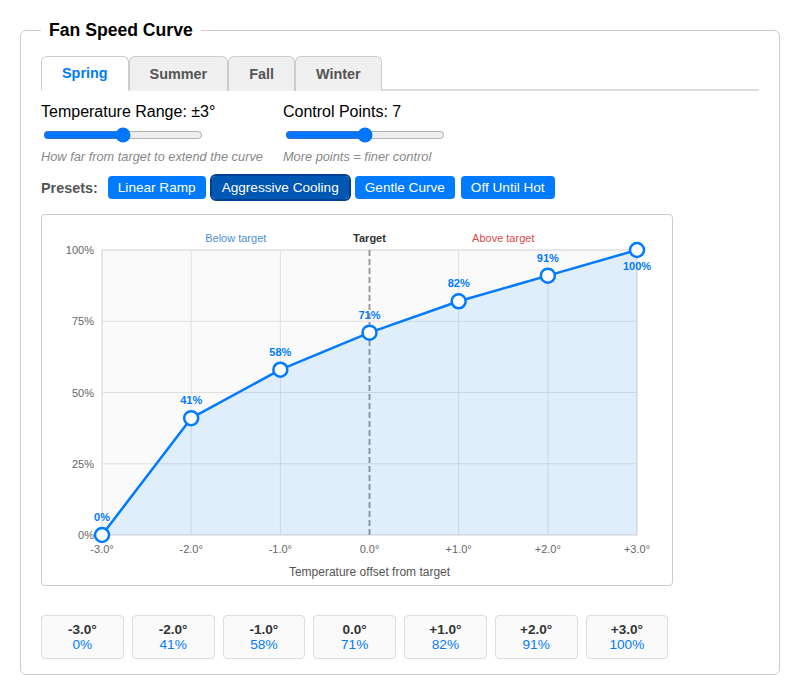
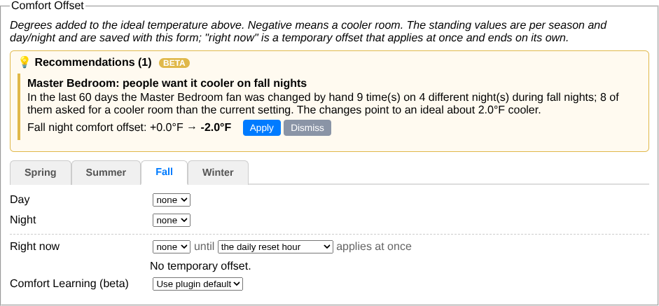

# Auto Fan - Indigo Plugin

Automatic fan speed control for [Indigo 2025.1](https://www.indigodomo.com/).

This plugin creates zones for each area where you have a ceiling fan controlled by Indigo, and uses sensor data to dynamically set the fan speed based on the current conditions. The idea is inspired by "smart" fans that adjust speed according to temperature, but this plugin allows for a much more granular level of control because it aggregates data from all of the sensors linked in Indigo.

## Features

### Automatic Fan Speed

The plugin automatically adjusts fan speed based on data from your existing Indigo devices:

- **Temperature sensors** — Reads one or more sensors per zone and compares to your ideal temperature to determine how fast the fan should run. Supports multiple sensors (averaged together).
- **Seasonal fan curves** — Each zone has four fan speed curves (spring, summer, fall, winter) that map temperature offset to fan speed. Configure them visually with an interactive drag-and-drop chart editor, or apply presets like Linear Ramp, Aggressive Cooling, Gentle Curve, and Off Until Hot.

  
- **HVAC awareness** — Boosts fan speed when AC is cooling, or reduces it when the heater is running.
- **Humidity boost** — Increases fan speed when humidity is above a threshold.
- **Night window** — Each zone defines per season when it counts as night (default 10 PM to 8 AM). The nighttime speed limits, nighttime locks and the day/night split of comfort offsets all read this one definition.
- **Nighttime mode** — Per-season speed limits that apply during the night window so fans don't blast at 3am.
- **Presence detection** — Uses a global home/away variable to limit fan speed when no one is home.
- **Ideal temperature** — Per-season ideal temperature settings. Each season can independently use a static value, an Indigo variable, or thermostat setpoints. The thermostat source respects the HVAC mode: cool-only mode uses the cool setpoint, heat-only mode the heat setpoint, and auto mode the midpoint of both. An optional per-season maximum can cap the thermostat-sourced ideal so it never rises above a chosen value (entered in the same units as your thermostat, °F or °C). This lets you target a cooler ideal in summer and a warmer one in winter.
- **Season detection** — Automatic detection based on calendar month with hemisphere support (Northern/Southern), or driven by an Indigo variable for full manual control.
- **Outdoor temperature** — Displays outdoor temperature from a configured weather device on each zone's Indigo device state.
- **BAF/Haiku fan support** — Automatically detects Big Ass Fans controlled by the [BAF Control plugin](https://github.com/webdeck/Indigo-BAF-Control) and uses native 8-speed control (0-7) instead of Indigo's standard 4-speed mapping. Falls back gracefully if the BAF plugin is disabled. No configuration needed.
- **Multi-device support** — Works with SpeedControl, Dimmer, Relay, and BAF/Haiku fan devices. Device type is detected automatically at runtime.

### Manual Override (Zone Locking)

When someone manually changes a fan speed — via wall switch, remote, Indigo UI, Siri, etc. — the zone **locks** and automation pauses for that zone. A fan report that merely confirms the speed the plugin itself asked for is never treated as a manual change.

- **Hold locks at nighttime** (default on, overridable per zone): a change made inside the zone's night window locks until the window ends, so a bedroom fan raised at 10 PM stays where it was put until morning. A sleeping room's motion sensor goes quiet, so night locks are time-based, not occupancy-based.
- **Daytime locks** last the configured duration (default 60 minutes) and extend by the extension value (default 30 minutes) for as long as presence is detected, up to a maximum (default 10 hours) so a stuck sensor cannot hold a fan forever.
- A further manual change during a lock restarts it.
- The house going **Away** releases every lock.
- Locks are persisted beside the config, so a plugin restart or a config save in the web editor no longer wipes them.
- Locks can be cleared manually via the plugin menu, Indigo actions, or the web interface.
- Every manual change and every lock release is written to a record beside the config (`state/overrides-YYYY-MM.jsonl`, kept 400 days) with the room conditions at that moment, the step the plugin had set and the step the person chose. The lock is taken at the fan's first report, but the change is recorded (and its temporary offset derived) once the fan has stayed on one step for 30 seconds: one adjustment often arrives as several reports (off, then step 1, then step 3) and is recorded once, at the step it settled on. *Plugins → Auto Fan → Print manual change summary* prints the last 30 days per zone, season and day/night. This record is what comfort learning reads.

### Comfort Offsets

A comfort offset is a number of degrees added to a zone's ideal temperature. It is the plugin's answer to "it's hot in here tonight" without rewriting the fan curve.

- **Temporary offset from a manual change.** When someone changes the fan, the plugin runs the season's curve backwards from the step they chose: that gives the temperature difference that would have produced it, and so the ideal they were acting on. The gap to the configured ideal becomes a temporary offset (rounded to 0.5°F, capped at ±3°F). At either end of the curve a change only bounds the ideal: turning the fan off (or below the curve's lowest speed) in a room already colder than the curve's end says nothing about "cooler", so it sets no offset; it counts only when it points warmer (and the reverse at the curve's top speed). Made at night it lasts until the night window ends; made by day, until the night window begins. So when the lock ends, automation resumes from the person's preference instead of snapping back.
- **Set one by hand.** In the Comfort Offset section of a zone's page ("right now", applies as soon as you pick a value) or with the Indigo actions *Set Comfort Offset* and *Clear Comfort Offset*: a degree cooler until the night window ends, until the daily reset hour, or for a number of hours. Siri and action groups can use the actions.
- The effective ideal is shown on the zone device (`ideal_temperature`, `configured_ideal_temperature`, `comfort_offset_temporary`, `comfort_offset_expires`) and explained in every speed-change log entry.
- Temporary offsets survive restarts and config saves.

### Comfort Learning (Recommendations) — beta

*Beta: recommendations never change anything on their own, and feedback is welcome (GitHub issues or the Indigo forum). Set Comfort Learning to Off, plugin-wide or per zone, to turn them off.*

Once a day, at the Daily Reset Hour, the plugin reads the record of manual changes and asks, per zone, season and day/night, what standing comfort offset would have made them unnecessary. It also notices when locks keep ending too early, and when people turn the fan up on some nights and down on others. The result is a **recommendation**, never a change:

- **Standing comfort offset**: at least 3 manual changes on 3 different days in the same season and half of the day (for the night half, nights: a change at 03:00 belongs to the night that began the evening before); changes less than 15 minutes apart are one decision and count where the person ended up (set 43%, then 29% ten minutes later, counts as 29%); each day or night weighs the same however many decisions it holds; evidence loses half its weight every 21 days; the proposal is the weighted median of what people asked for, in 0.5°F steps within ±3°F.
- **Night speed limits**: when at least 5 nights in a season had a manual change, and on at least 20% of them (2 or more) people turned automation's speed up while on as many others they turned it down, no offset can fit: it moves the whole curve one way. The plugin recommends *Min/Max Speed at Night* covering where people left the fan on the middle 80% of those nights (in the editor's 10% steps) and stops recommending a night offset for that season.
- **Lock rule**: when more than 30% of at least 5 lock releases were followed by another manual change within the hour, it recommends holding locks at nighttime (if off) or a lock duration half again as long.
- Nothing is recommended during the first 7 days of records or within 7 days of a change to the same setting. There is one open recommendation per setting: each run re-reads the evidence and replaces it when the evidence now points to a different value, or withdraws it when the evidence no longer supports a change. An open revert stays until someone applies or dismisses it. A hand edit of a setting dismisses its open recommendation.
- Recommendations appear in the Indigo log, as `open_recommendations` on the zone device (trigger a notification from it), as a badge on the Zones list, and on the zone's page with **Apply** and **Dismiss** inside the section that owns the setting (comfort offsets in *Comfort Offset*, night speed limits in *Nighttime Modifier*, lock settings in *Lock Behavior*); the "right now" strip at the top links to them. Apply writes the setting into the config with an automatic backup and reloads.
- Every applied change is watched for 14 days and compared with the 14 days before it as a share: days (nights) with a manual change out of the days that count. A day counts when the record had already begun, it falls in the recommendation's season and the house was home (the plugin notes the days it sees the house home; days before it started noting count as home). If the share did not fall, a revert is recommended with the numbers; with no counted days on either side the watch ends inconclusive.
- *Comfort Learning* is set plugin-wide on the Auto Fan page (**Suggest** or **Off**) and per zone (**Use plugin default**, **Suggest** or **Off**). **Off** stops recommendations only: manual changes still lock the fan, set a temporary offset and are recorded. *Plugins → Auto Fan → Run comfort learning now* and *Print open recommendations* are there for checking.

### Smart Logging

When multiple sensors for a zone update simultaneously, the plugin aggregates all changes within a 1-second window and produces a single consolidated log entry showing everything that changed and the resulting speed decision.

### Web Configuration

Browser-based config editor accessible via Indigo's plugin menu (**Plugins → Auto Fan → Open Web Configuration**) for managing zones, curves, and modifiers.

## Installation

1. Download the latest release zip
2. Double-click to install in Indigo, or copy `Auto Fan.indigoPlugin` to your Indigo Plugins folder
3. Enable the plugin in Indigo's plugin menu

## License

MIT. See [LICENSE](LICENSE).
